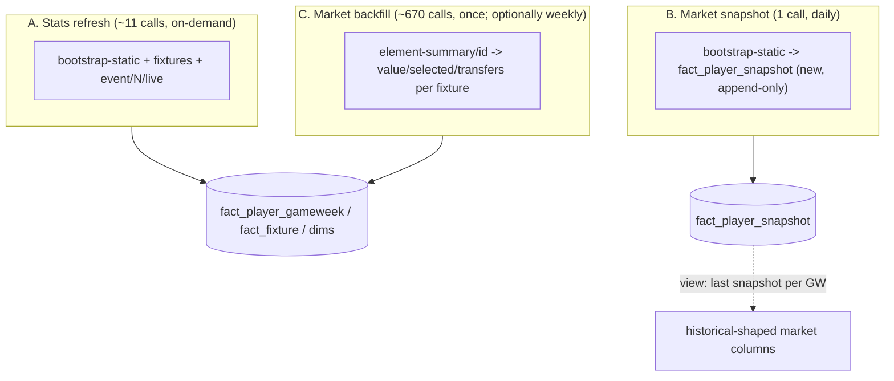

# Live FPL API Connector — Plan, Findings & Build Checklist

**Status (2026-10-31): extract stage built; common helper extracted; schema
changes, loaders and backfill NOT built.** Self-contained so any session can
pick up from here. Read the main `README.md` (schema, data flow) first, and
`CLAUDE.md` "Data-modeling gotchas". Local-only doc (not committed) per
`CLAUDE.md` — plans stay uncommitted until the user says otherwise.

## TL;DR for a new session

- Goal: keep **2026-27** rows in DuckDB fresh between the GitHub repo's
  infrequent refreshes. At the time of writing the warehouse had only **GW1**
  of 2026-27 (610 `fact_player_gameweek` rows, `source='github_repo'`) while
  the live API was at **GW9** (GW8 finished).
- The data is **real EPL footballers' stats and fantasy points** (plus club
  and fixture data). It is **not** data on FPL managers/squads — those
  endpoints (`/api/entry/<id>/...`) need auth and are out of scope. The only
  manager-side signal is crowd aggregates (ownership %, transfers, price).
- Decided architecture: **three separate ingestions with different cadences**
  (A stats, B market snapshot, C market backfill) — see "Design". Refresh is
  **on-demand** (manual command); scheduling can be layered on later.
- Next step when picking up: `db/migrations/001_live_data.sql` is applied (S1/S2 done); next is S3 (view)
  and ingestion A, starting with R1 (new-player reconciliation).

## Why this is needed

`vaastav/Fantasy-Premier-League` (see `ingestion/github_historical.py`)
stopped weekly updates after 2024-25; it now refreshes ~3x/season. The live
API `fantasy.premierleague.com/api/*` is what that repo scrapes. It is fully
public and unauthenticated (plain `curl` returns 200).

## API exploration results (2026-10-31, real data, GW9 in progress)

Raw sample pull: `~/epl-data/raw/live_api/20261031T130811Z/` (bootstrap 1.9 MB,
fixtures 336 KB, event_live 1..9 4.4 MB total). Saved as single-line JSON; view
with `jq`, VS Code "Format Document", or `duckdb read_json`.

### Endpoints

| Endpoint | Verified contents |
|---|---|
| `GET /bootstrap-static/` | Top-level keys: `elements` (669 players, 109 fields each), `teams` (20; `id`, `code`, `name`, `short_name`, strength fields), `events` (38 GWs: `id`, `deadline_time`, `finished`, `is_current`), `total_players`, plus config (`chips`, `phases`, ...). **Current snapshot only** — no history. |
| `GET /fixtures/` | 380 fixtures: `id`, `event`, `team_h`, `team_a`, `team_h_score`, `team_a_score`, `team_h_difficulty`, `team_a_difficulty`, `finished`, `kickoff_time`. |
| `GET /event/<gw>/live/` | `elements[i] = {id, stats, explain, modified}`. `stats` = per-player totals for the GW (**summed across fixtures**). `explain` = list of `{fixture, stats:[{identifier, points, value, points_modification}]}`, one entry per fixture. |
| `GET /element-summary/<player_id>/` | `history` (per-fixture rows, current season) + `history_past`. Verified fields per row: all the stats below **plus** `value`, `selected`, `transfers_in`, `transfers_out`, `transfers_balance`, `fixture`, `opponent_team`, `was_home`, `kickoff_time`, `round`, scores. This is the only source of weekly market data. |

### `event/<gw>/live` — what stats we get per footballer

`stats` keys (29): `minutes`, `starts`, `played`, `total_points`, `bonus`, `bps`,
`goals_scored`, `assists`, `clean_sheets`, `goals_conceded`, `own_goals`,
`saves`, `penalties_saved`, `penalties_missed`, `yellow_cards`, `red_cards`,
`influence`, `creativity`, `threat`, `ict_index`, `expected_goals`,
`expected_assists`, `expected_goal_involvements`, `expected_goals_conceded`,
`clearances_blocks_interceptions`, `recoveries`, `tackles`,
`defensive_contribution`, `in_dreamteam`. (ICT and expected_* values arrive
as **strings** — cast to numeric.)

- **23 map onto existing `fact_player_gameweek` columns**: minutes, starts,
  total_points, goals_scored, assists, clean_sheets, goals_conceded, own_goals,
  bonus, bps, influence, creativity, threat, ict_index, expected_goals,
  expected_assists, expected_goal_involvements, expected_goals_conceded,
  yellow_cards, red_cards, saves, penalties_saved, penalties_missed.
- **6 are NOT in our schema yet**: `tackles`, `recoveries`,
  `clearances_blocks_interceptions`, `defensive_contribution` (FPL's newer
  defensive-action stats; historical seasons would be NULL) and `played`,
  `in_dreamteam` (low value; likely skip).

### Gaps vs. the historical `fact_player_gameweek` (Open Question 1, resolved)

`explain` is a **scoring breakdown only**: in GW8 it contained just 11
identifiers (`assists, bonus, clean_sheets, defensive_contribution,
goals_conceded, goals_scored, minutes, own_goals, red_cards, saves,
yellow_cards`). It omits `bps`, `ict_index`, `influence`, `creativity`,
`threat`, all `expected_*`, `starts`, `tackles`, etc. Consequences:

| Column | Live source |
|---|---|
| 23 stats above | `event/live` `stats` (aggregate per GW). For single-fixture players (almost every row) merge directly. **For double-gameweek players the non-scoring fields cannot be split per fixture from this endpoint** → use `element-summary` for just those players. No DGW has occurred in 2026-27 yet, so that path is untestable until one does. |
| `fixture_id` | `explain[].fixture` |
| `opponent_team_code`, `was_home`, `team_code` | join `fixture_id` to `fixtures.json`; team from `bootstrap-static` element `team`/`team_code` |
| `value` (weekly price), `selected` (weekly ownership), `transfers_in/out/balance` | **No live-endpoint source.** `element-summary` `history` has them per fixture. `bootstrap-static` has only current snapshot fields (`now_cost`, `selected_by_percent`, `transfers_in_event`, `transfers_out_event`, `cost_change_event`). |
| `fact_player_season` fields | `bootstrap-static`: `element_type` (position), `team_code`, `now_cost`, `selected_by_percent`, `now_cost_rank`, `points_per_game`, `form`, `total_points`, `minutes`. `start_cost`/`end_cost` must be derived (historical loader backfills `start_cost` from earliest GW `value`). |

### Rate limits

None documented; none hit. The vaastav scraper has long made ~700 sequential
`element-summary` calls per run without known issues. Plan: sequential with a
short sleep (~0.2s → ~2–3 min for 670 calls), plus the retry/backoff already in
`live_api.py` (retries on connection error, timeout, 429, 5xx). Not stress
tested — time a small batch first if concerned.

## Identity-matching verification (2026-10-31, read-only against `db/epl.duckdb`)

Live API vs. the warehouse's 2026-27 historical rows — all keys line up:

| Check | Result |
|---|---|
| Team `code` -> `dim_team` | 20/20 matched, names identical |
| Team `id` vs `fact_team_season.team_id_that_season` (2026-27) | 20/20 equal |
| Player `code` -> `dim_player` | 634/669 matched; **35 are new players** (23 already have minutes) -> `dim_player` upsert must add them |
| Player `id` vs `fact_player_season.player_id_that_season` (2026-27) | 616/616 equal; all 616 warehouse players are in the live data |
| Player `id` across seasons | differs for 477/482 returning players -> confirms: key on `code`, never `id` |
| Fixture `id` -> `fact_fixture` (2026-27) | 380/380 matched, same home/away teams, same gameweek |
| GW1 `event_live` vs `fact_player_gameweek` GW1 | 610/610 rows match on (player_code, fixture_id); `total_points` and `minutes` equal on all 610 |

Surprises to handle in the loader:
- **15 players have changed club** since the warehouse's 2026-27 load (e.g.
  N.Jackson Chelsea -> Aston Villa, Ndiaye Everton -> Man City). The live
  `team` is the *current* club, so upserting `fact_player_season.team_code` is
  right. **But** for `fact_player_gameweek`, using the current club for earlier
  GWs would mislabel movers' earlier rows. Derive `team_code` per fixture
  instead (the player's club is whichever of `team_h`/`team_a` they played
  for — ambiguous from `event_live` alone; `element-summary` gives `was_home`
  + `opponent_team`, so C resolves it). Until then, for movers keep the
  existing GW rows' `team_code` where present and flag others.
- `web_name` can differ by formatting (`N.Angulo` live vs `Angulo` in
  `dim_player`); `code` is the key, so just let the upsert overwrite names.
- `fact_player_season` has a single `team_code` per season, so a mid-season
  mover keeps only their latest club there (pre-existing limitation).

## Design (decided with the user, 2026-10-31)

1. **Three ingestions, different cadences** (no need for one monolith):
   - **A. Stats refresh** — `bootstrap-static`, `fixtures`, `event/<gw>/live`
     for GW1..current. ~11 calls. On-demand. Fills performance stats, fixtures,
     dims, season facts.
   - **B. Market snapshot** — one `bootstrap-static` call, daily (on-demand
     first). Writes a **new append-only table `fact_player_snapshot`**, keyed
     `(player_code, snapshot_at)`: `now_cost`, `selected_by_percent`,
     `transfers_in_event`, `transfers_out_event`, `cost_change_event`,
     `gameweek` (current event), plus lineage columns. Finer-grained than the
     historical per-GW grain, so it is *not* forced into `fact_player_gameweek`;
     a view collapses the last snapshot per GW into the historical shape.
     Mapping notes: absolute `selected` ≈ `selected_by_percent` ×
     `total_players` / 100; historical `transfers_in/out` = per-GW flow =
     `transfers_in_event` / `transfers_out_event`; `value` = `now_cost`
     (tenths of £m, same as historical). New capability vs history: intra-week
     price/ownership movement.
   - **C. Market backfill** — `element-summary/<id>` for every player (~670
     calls), **one-time** to fill `value`/`selected`/`transfers_*` for the
     already-played GWs (snapshots can't recover the past). Optionally re-run
     weekly after each GW finishes to correct drift. Also the fallback for
     double-gameweek fixture-level stats.
2. **Add the four defensive-stat columns** (`tackles`, `recoveries`,
   `clearances_blocks_interceptions`, `defensive_contribution`) to
   `fact_player_gameweek` in the same schema change (NULL for old seasons).
   Skip `played`, `in_dreamteam`.
3. **Refresh cadence: on-demand** (manual command) first; cron/launchd later
   without connector changes.
4. In-progress GW data isn't final (BPS/bonus shift). Not special-cased:
   upserts converge on re-run.

## Design rules carried over from the historical pipeline — do not re-derive

1. **Key on `code`, not `id`** (`id` is reassigned every season). Season-scoped
   `id` stays on fact tables where raw data references it. Single-season data
   makes the crosswalk simpler than `build_team_crosswalk()` in
   `load_historical.py`.
2. **`fact_player_gameweek` grain is player-per-*fixture***, PK
   `(season_id, gameweek, player_code, fixture_id)`. Real double gameweeks exist.
3. **Upsert, never delete** — use `common.upsert_df(con, table, df)`.
4. **Vectorize** pandas transforms; no `.iterrows()`.
5. **Lineage columns** on every row: `source='live_api'`, `source_ref` = fetch
   timestamp (ISO 8601; no commit SHA exists), `loaded_at`. One `ingest_runs`
   row per run. Upserting overwrites the `github_repo` rows for 2026-27 — expected.
6. **Raw landing zone outside this repo**: `~/epl-data/raw/live_api/<UTC timestamp>/`
   (a new subtree next to `raw/github/` in the `epl-data` repo).
   Unlike the GitHub landing zone, each run keeps its own timestamped
   directory; pruning old ones is an open item.
7. Scripts run from `ingestion/` (they `import config` / `from common import ...`),
   with the repo `venv` active: `cd ingestion && python live_api.py`.

## Build checklist

Mark items `[x]` with the date as they're completed. Verify against the code,
not just this list.

### Done
- [x] API exploration against live endpoints (2026-10-31) — findings above
- [x] `ingestion/common.py` — `upsert_df(con, table, df)` extracted from
      `load_historical.run()`; `load_historical.py` imports it (import checked;
      **historical load not re-run** after the refactor — re-run or verify
      idempotently before relying on it)
- [x] `ingestion/config.py` — `FPL_API_BASE`, `LIVE_RAW_DATA_DIR`,
      `LIVE_MAX_ATTEMPTS`
- [x] `ingestion/live_api.py` (extract for A) — fetches bootstrap-static,
      fixtures, `event/N/live` for every current/finished GW; retry/backoff;
      derives `season_id` (`2026-27`, matches `dim_season.is_current`); writes
      `manifest.json` (`source`, `fetched_at`, `season_id`, `gameweeks`).
      Verified: ran successfully, GW1–9 landed.
- [x] PR #10 review fixes in `live_api.py` / `config.py` / `schema.sql`
      (2026-10-31): atomic landing (writes `<ts>.partial`, renames after the
      manifest); non-JSON 200 responses retried; clear error when `events` is
      empty (between seasons); `LIVE_REQUEST_PAUSE_SECONDS` (0.2s) after each
      successful call; `fact_player_snapshot` comment no longer implies the S3
      view exists. Checked by re-running the extract and unit-testing the retry
      and empty-events paths with mocks.

### Schema (do first; show the user the DDL before applying)
- [x] **S1** Four defensive-stat columns added to `fact_player_gameweek` in
      `db/schema.sql`; `db/migrations/001_live_data.sql` (idempotent `ALTER`s)
      brings an existing DuckDB file up to date. Tested on a copy (2026-10-31),
      run twice, views still work. **Applied to `db/epl.duckdb` 2026-10-31** (backup at
      `db/epl.duckdb.bak`, untracked — delete once satisfied). Verified: row
      counts, point/minute/goal/bps sums and view counts identical before/after;
      new columns all NULL; 2nd run a no-op.
- [x] **S2** `fact_player_snapshot` created in `db/schema.sql` + same migration
      file. PK `(season_id, player_code, snapshot_at)`; columns: `gameweek`,
      `now_cost`, `selected_by_percent`, `total_players`, `transfers_in_event`,
      `transfers_out_event`, `cost_change_event`, lineage. Fresh `schema.sql`
      build verified. Applied (see S1); `fact_player_snapshot` exists, empty, with its PK and 2 FKs.
- [ ] **S3** View collapsing last snapshot per GW into historical-shaped market
      columns (name suggestion: `v_player_gameweek_market`)
- [ ] **S4** Update `README.md` schema diagram/tables

### Ingestion A — stats refresh (`ingestion/load_live.py`)
- [x] **A1** (`latest_pull_dir()` in `load_live.py`) Read latest `raw/live_api/<ts>/` + manifest. Only consider
      directories **without** the `.partial` suffix (extract renames on success;
      a leftover `.partial` is a failed pull and safe to delete)
- [x] **A2** (in `load_live.py`) Upsert `dim_season` (current; flip previous `is_current` to false)
- [x] **A3** (in `load_live.py`) Upsert `dim_team`, `dim_player` from bootstrap `teams`/`elements`
- [x] **A4** (built in `load_live.py`, 2026-10-31; not yet run on the real DB)  Upsert `fact_team_season`, `fact_player_season` (2026-27 only;
      cast string numerics)
- [x] **A5** (built, same caveat)  Upsert `fact_fixture` from `fixtures.json` (scores NULL for
      unplayed fixtures)
- [x] **A6** (built, same caveat)  Upsert `fact_player_gameweek` from `event_live`: one row per
      `explain` entry; merge `stats`; derive opponent/home/team from fixtures;
      cast ICT/expected strings; `team_code` caveat for club-movers (see identity-matching section). Guard: if a player has >1 `explain` entry in a
      GW, fail loudly (or route to C) rather than loading aggregate stats onto
      each fixture row
- [x] **A7** (built, same caveat)  Log `ingest_runs` (`source='live_api'`)
- [x] **A9** (2026-10-31, user decision) Load **finished gameweeks only**: the
      loader intersects the manifest's gameweeks with `bootstrap-static` `events[].finished`
      and skips the in-progress one (the raw pull keeps it). `fact_player_season`
      `total_points`/`minutes` are summed from the loaded GW rows instead of taking the
      API's season totals, which include the in-progress GW. The skipped GW lands on the
      first run after it closes. Tested on a copy: GW1-8 loaded, GW9 skipped, season
      totals == sum of loaded GWs for 669/669, re-run identical.
- [~] **A8** Validated on a copy, then **run on the real `db/epl.duckdb` 2026-10-31**
      (backup `db/epl.duckdb.pre-facts.bak`; GW1-8 loaded, GW9 skipped, 259,110
      `fact_player_gameweek` rows, older seasons untouched at 253,890, re-run
      identical, 0 NULL club columns). Copy-run details:
      - GW1: all 610 existing rows unchanged across every stat column, `team_code`,
        `opponent_team_code`, `was_home` and the market columns (`value`, `selected`,
        `transfers_*`) — the live transform reproduces the GitHub rows exactly
      - 259,779 `fact_player_gameweek` rows afterwards (+5,279, GW2-9); re-run gives
        identical counts
      - (before A9) per-player sum of GW `total_points`/`minutes` equalled `bootstrap-static`'s
        season totals for 669/669 players; after A9 it equals the loaded-GW sum instead
      - 0 rows with unresolved club; no NULL `team_code`/`opponent_team_code`/`was_home`;
        0 NULL `start_cost` for 2026-27
      - Still to do: eyeball one player against the FPL website
      Implementation notes: club per row = current club if it is in the fixture, else
      the club already stored for that row, else the player's latest stored club (handles
      the 17 GW1 / 8 GW2 rows for players who moved clubs); `start_cost` = `now_cost -
      cost_change_start`; team standings columns (`played`/`win`/.../`position`) and the
      `strength` column are deliberately not written (API values are zero/null); a player
      with >1 fixture in a GW makes the loader raise (see C2/D1). Market columns on
      GW1 rows keep their GitHub values but their `source` now reads `live_api`.

### Ingestion B — market snapshot
- [ ] **B1** Extract: one `bootstrap-static` fetch (reuse `live_api.py`
      helpers; separate entry point so it can run on its own schedule)
- [ ] **B2** Load into `fact_player_snapshot` (append; PK `(player_code, snapshot_at)`)
- [ ] **B3** Validate view `v_player_gameweek_market` against a backfilled GW

### Ingestion C — `element-summary` backfill
- [ ] **C1** Extract: fetch all players sequentially with short sleep; land
      under the timestamped raw dir (e.g. `element_summary/<id>.json`)
- [ ] **C2** Load: update `value`, `selected`, `transfers_in/out/balance` (and
      the four defensive stats) on existing `fact_player_gameweek` rows; for
      double-gameweek players this also supplies true per-fixture stats
- [ ] **C3** Re-derive `fact_player_season.start_cost` from earliest GW `value`
      (as `load_historical.py` does)
- [ ] **C4** Time a small batch first to confirm no 429s

### Reconciliation & history (added 2026-10-31; A3 depends on R1)
- [x] **R1** (built 2026-10-31 in `ingestion/load_live.py`, dims only; tested on a
      DB copy, **not yet run against `db/epl.duckdb`**) New-player + `dim_player` reconciliation (needed inside A3). The
      live `elements` carry every `dim_player` column: `first_name`,
      `second_name`, `web_name`, `birth_date` (655/669 populated), `region`.
      Proposed rule (confirm with the user): upsert on `player_code`; **insert**
      the 35 unseen players (before any fact rows, FK order); for existing
      players **overwrite** names/`region` with live values (live is
      fresher/canonical — e.g. `Angulo` -> `N.Angulo`), but **never overwrite a
      non-null `birth_date` with NULL** (use COALESCE(live, existing)). Log
      counts of inserted vs. changed players in `ingest_runs.notes`, and
      consider reporting which fields changed. Note the generic
      `upsert_df` overwrites every non-PK column, so R1 needs either a
      pre-merge in pandas (coalesce, then upsert) or a dedicated SQL upsert.
- [x] **R2** (covered by A4: position/team/start_cost for all 669 players)  Also reconcile `fact_player_season` for new players (position
      from `element_type`, team, etc.) and make sure each new `player_code`
      has a `dim_player` row first.
- [ ] **T1** (future) Record club transfers. Today a player's club is only
      stored as one `team_code` per season on `fact_player_season` (latest
      wins) and per row on `fact_player_gameweek`, so a mid-season move
      (15 detected at 2026-10-31) loses *when* it happened and where from.
      Idea: a `fact_player_team_history` (`player_code`, `team_code`,
      `from_gameweek`/`valid_from`, `valid_to`, lineage), populated by diffing
      `bootstrap-static` team vs. the last known team each run (and/or from
      `team_join_date`, which the API exposes), with the first run seeding the
      15 known movers. Would also fix the per-gameweek `team_code` caveat in
      A6. Not scoped yet — confirm design with the user before building.

### After DGW occurs (not testable earlier)
- [ ] **D1** Confirm two distinct `fixture_id` rows per affected player and
      that `v_player_gameweek_totals` sums them correctly

### Follow-ups
- [ ] **F1** Prune old `raw/live_api/<ts>/` directories and stale `.partial`
      ones (policy TBD). Each run currently re-lands ~4.4 MB of `event_live`
      into `~/epl-data`, which is a git repo, so this grows
- [ ] **F2** Scheduling (cron/launchd) for A/B once the user wants it
- [ ] **F3** Consider whether agent tools/views should surface the new defensive
      stats and snapshot data; update `docs/agent_ui_architecture_plan.md`
- [ ] **F5** Optional: skip re-downloading `event/<gw>/live` for gameweeks
      that were already finished in the previous complete pull (copy the files
      instead) — cuts calls and raw-dir growth. Raised in PR #10 review; not
      done (the plan's original choice was to reload everything each run)
- [ ] **F6** Minor, from review: `upsert_df` has no schema filter or column
      quoting and fails obscurely on a table with no PK (moved unchanged from
      `load_historical.py`)
- [ ] **F7** Compute `fact_team_season` standings (`played`, `win`, `draw`, `loss`,
      `points`, `position`) from `fact_fixture` — the API's values are zero/stale and
      the loader leaves those columns alone
- [ ] **F4** Optional: save raw JSON with `indent=2` for human readability

## Open questions

- Whether `played` / `in_dreamteam` are worth storing (default: skip).
- Raw-directory retention (F1).
- Whether weekly re-runs of C are needed or the daily snapshots suffice once
  the backfill is done (decide after seeing drift).
